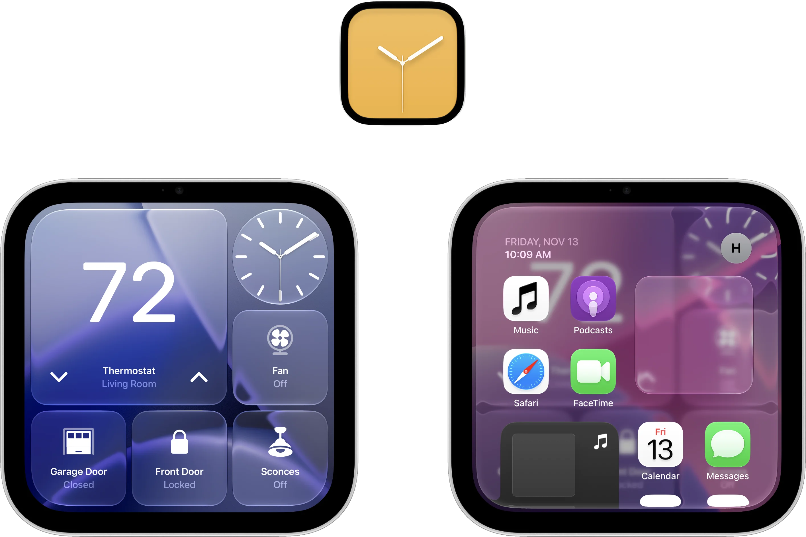

# vphone-cli for HomeView



## Features and Enhancements

This branch adds the following to the HomeView emulator:

This is a fork of [Lakr233/vphone-cli](https://github.com/Lakr233/vphone-cli),
including upstream 2.16.1 (through `d1c36fa8`) and the enhancements below.
Use this fork's `homeview` branch for the complete setup.

Upstream additions include a custom location picker, Location Services API,
screenshot cropping/scaling controls, and a system-camera source. The camera
source has not been validated on HomeView; pairing and recognition limitations
still apply. Our lossless PNG shortcuts and manual marketing clock are preserved.

- **HomeView Controls panel:** **Device → HomeView Controls…** provides guest
  toggles for display keep-awake, the cosmetic Wi-Fi indicator, Location
  Services, a selected profile's Personal Content, and the AirPlay video
  workaround. It also opens Now Playing, supplies a Cupertino demo location,
  selects faces, and adds missing built-in presets with a face-store backup.
  **Refresh Home Screen** refreshes cached icons after a guest date change.
  Helpers are bundled and uploaded automatically after a guest restart.
  Changes requiring a restart are identified. Initial setup bypass remains
  a firmware-install option; the local recognition-bypass experiment is not
  included. See [panel details](Research/Tools/HomeView/README.md#homeview-controls-panel).

- **Native HomeView app and icon:** optional `.app` packaging uses Dylan’s
  Icon Composer artwork with standard macOS rendering and no Dock nameplate.
  See [native app packaging](Research/Tools/HomeView/README.md#native-homeview-app-and-icon).
- **HomeView device frame:** wraps the live screen in the supplied bezel artwork.
  Toggle **Device → Show Device Frame**; dragging the bezel moves the window,
  while the screen keeps its normal touch mapping when resized. The area outside
  the device stays transparent, with a separate native toolbar background.
  The updated artwork closes the small seam at the screen cutout.
- **Hide or show the toolbar:** **Device → Show Toolbar** toggles the entire
  titlebar, including the window buttons, FPS, and Home button. The preference
  is remembered; use the same menu to bring it back, or drag the device bezel
  to move the window while the toolbar is hidden.
- **Live FPS display:** **Device → Show Frame Rate** replaces the IP address
  in the window subtitle with the guest’s frame rate.
- **Keep the display awake:** optional HomeView preferences select Never for
  automatic screen-off and extend the idle-dimming timer. See the
  [configuration and restore instructions](Research/Guest/homeview_display_idle.md).
- **Responsive rendering and restored icons:** scoped BreadBoard Metal compiler
  and IconServices fixes address severe stalls and missing dashboard icons.
- **Accurate touch input:** clicking and dragging continue to map correctly
  after resizing the emulator window.
- **Lossless HomeView screenshots:** in the HomeView app, **Control–Command–S** saves a native-resolution
  PNG directly from the VM display, without JPEG compression or window scaling.
  **Control–Command–C** copies a PNG to the Mac clipboard. Captures contain the
  guest display, without the host toolbar or device frame.
- **Hide the disconnected Wi-Fi indicator:** an opt-in research helper supplies
  a simulated connected status for screenshots. It is cosmetic and session-only;
  see the [enable/disable instructions](Research/Tools/HomeView/README.md#cosmetic-wi-fi-status-indicator).
- **Date and time controls:** set a custom guest clock, restore the Mac’s time,
  or choose **Device → Set to Marketing Date & Time** (**Control–Command–D**) for November 13, 2026,
  10:09:20 AM in the Mac’s time zone. Manual clocks continue ticking.
- **Setup bypass:** a reversible option gets to the dashboard without nearby
  iPhone setup; it does not configure an Apple Account or HomeKit.
- **Personal Content control:** an opt-in research helper enables the native
  setting for a local demo profile, with read-back verification. Recognition,
  paired-iPhone, and account/network requirements remain separate. See the
  [research tool instructions](Research/Tools/HomeView/README.md#personal-content-for-a-local-demo-profile).
- **Manual Location Services control:** an opt-in guest helper enables the
  native switch, allowing the emulator’s location controls to supply a demo
  location such as Cupertino. See the [location instructions](Research/Tools/HomeView/README.md#location-services).
- **More clock faces and sample tiles:** research tools add Home Modular,
  including Apple’s populated sample layouts, and additional built-in face
  presets while preserving existing faces. See the
  [face and asset tools](Research/Tools/HomeView/README.md).
- **AirPlay video from the host Mac:** a documented, reversible guest setting
  enables the tested QuickTime video presentation path. Follow the
  [AirPlay setup notes](Research/Guest/homeview_airplay.md).
- **AirPlay music interface:** the native Now Playing view can display artwork,
  track information, and controls from the Mac’s Music app. Playback can stall;
  this is verified as a visual preview, not working sound.
- **Wallpaper extraction tools:** extract bundled background images locally;
  Apple’s artwork and firmware are not redistributed in this repository.

Some enhancements require the setup steps or research tools below; cloning
the repository does not apply them to an existing VM. Apple service
authentication, recognition, real cameras, and account-backed content remain
separate limitations. See [HomeView notes](HOMEVIEW.md) for validation details.

## Set up HomeView with a coding agent

Give the following prompt to an agent that can run commands and inspect apps
on your Mac. This repository is public; no GitHub account or invitation is
needed to read or clone it. [Download HomeView firmware from Apple](#get-the-homeview-firmware)
or let the agent use this branch's firmware catalog; firmware and a ready-made
VM are **not included** in this repository. This HomeView build
requires **macOS 27 or later** for OTA extraction and **Xcode 27** for the source
build. Plan for roughly **100 GB of free space** during setup. The original,
general-purpose vphone README follows this HomeView-specific prompt.

```text
Set up a working HomeView emulator on this Mac using the homeview branch of:
https://github.com/DylanMcD8/vphone-cli

Please do the setup and verify it works, rather than just giving me a plan.
Use a dedicated HomeView-OS folder in my home directory, or reuse an existing
checkout/VM there after inspecting it. Preserve existing files and VMs. Keep
a short progress/resume note in that folder for any reboot or manual step.

1. Check this Mac's Apple Silicon model, macOS version, RAM, free disk space,
   Xcode installation/license/selected developer directory, and host security
   state. This HomeView OTA needs macOS 27+ and the build needs Xcode 27.
   Budget roughly 100 GB free for extraction, restore inputs, and the VM.
   Report a missing requirement before starting large downloads or restores;
   do not delete my data to make space.

2. Clone the public repository's homeview branch over HTTPS, or reuse an
   existing checkout of that branch. No GitHub login or token is needed:
   git clone --branch homeview https://github.com/DylanMcD8/vphone-cli.git vphone-cli
   Run the clone command from the working folder, then enter vphone-cli. Read
   AGENTS.md, HOMEVIEW.md, Skills/vphone-guest-control/SKILL.md and its relevant
   references, Documents/en/get-started/host-setup.md, Documents/en/get-started/quick-start.md,
   Research/Firmware/homeview_bringup.md, Research/Guest/host_clock_sync.md,
   and Research/Tools/HomeView/README.md. Use this branch's code and guides,
   not an upstream release that may omit these HomeView fixes. Historical
   notes contain another machine's paths and UUIDs: discover mine instead.

3. Reuse my supplied HomeView firmware if present; otherwise use the Apple
   download linked in README's "Get the HomeView firmware" section and this
   branch's firmware catalog. Verify its size and SHA-256 before using it.
   Do not ask me to find firmware that the catalog can already download. The tested
   combination was HomeView 27.2 (24V514), HomeAccessory17,1/J490, and cloudOS
   26.4 (23E5207q), using the documented Apple TV restore-base/OTA workflow.
   A HomeView full OTA/AEA is not a restore IPSW. Inspect the current CLI help
   and firmware preparation code for the correct inputs, required restore
   base, and any OTA metadata/decryption material. Fetch supported inputs
   from official sources when available; identify missing inputs explicitly.
   The catalog includes the HomeView OTA URL and key, Apple TV HD 26.6 restore
   base, and matching cloudOS source. For a local OTA, use the catalog filename
   HomeAccessory17,1_27.2_24V514_OTA.aea so the catalog can recognize it;
   alternatively use its exact catalog URL.
   Do not assume another build or a currently unavailable signing ticket works.

4. Build the patched bundle from this checkout:
   xcodebuild -workspace VPhone.xcworkspace -scheme VPhone -configuration Debug -destination 'platform=macOS,arch=arm64' -derivedDataPath .build/XcodeBundle build
   Use the vphone-cli in that built VPhone.bundle for subsequent commands.
   Run host preflight and bundle validation. Prefer the documented SIP-enabled
   path with debugging restrictions relaxed and Research Guests enabled when
   supported. Do not silently change SIP, boot-args, or other host security
   settings. If Recovery or administrator authorization is required, give me
   the exact steps/command, explain why, and wait for me to perform them.
   Prepare everything possible first. A rebuilt VM executable may need its
   current signature allowlisted again; do not reuse an old cdhash.

5. Create a HomeView VM with the homeview preset and HomeAccessory17,1 identity.
   The tested VM used 8 CPUs, 8 GiB RAM, and a 64 GB disk; size it sensibly for
   this Mac. Use the branch's existing firmware prepare/patch/restore/install
   flow, inspecting --help rather than guessing flags. Confirm the scoped
   BreadBoard Metal compiler and IconServices lookup fixes are included.
   Verify a native boot and save a stopped snapshot before enabling the
   documented reversible system-homeview-exp-setup_bypass. I want the usable
   dashboard, so enable that bypass after the baseline is saved. It does not
   configure an Apple Account, recognition, HomeKit, or nearby-iPhone pairing.

6. Add the Home Modular normal face and Apple's populated nine-tile sample
   using Research/Tools/HomeView, then add missing presets from AdditionalFaces.json.
   Build the helper for the guest; do not run the tvOS executable on the Mac.
   Back up the current face store, skip existing provider/descriptor pairs,
   and preserve all existing faces. Use this VM's returned configuration UUIDs.
   Creation can change the selection; leave the nine-tile Home Modular sample
   selected at the end. Explain that sample accessory tiles are demo content.

7. Verify the VM visibly renders and responds promptly: real dashboard icons,
   clicking an app, scrolling from the middle, and correct touch mapping after
   resizing the window. Verify Control-Command-S saves a screenshot, and the
   Device menu's date/time override and reset work; finish on automatic time.
   Check basic guest networking separately from Apple service authentication.
   Safari can work while Music/Weather fail request signing; do not promise
   that Wi-Fi emulation or an Apple Account will fix those failures. Camera,
   Photos, HomeKit, recognition, and Snoopy downloads may need unavailable
   hardware, account setup, content, or services.

8. For AirPlay video from this Mac, read Research/Guest/homeview_airplay.md.
   Back up existing guest feature overrides and apply the documented
   PebbleAirPlayVideoInNowPlaying=false workaround, preserving other settings.
   Reboot the guest and verify a fresh connection from QuickTime displays video.
   The tested host-Mac route works with NAT; do not change the network mode
   unnecessarily. Do not claim audio, protected content, or iPhone discovery
   works unless separately tested.

Finish with a working launcher or exact launch command, the VM/bundle paths,
the validation results, and any remaining limitations. Keep firmware, VM disks,
credentials, and extracted Apple assets out of Git. Continue through routine,
reversible setup steps; pause when you genuinely need my input or a manual
Mac security/administrator action. Do not claim success from a build alone.
```

### Get the HomeView firmware

The tested image is **HomeView 27.2 (24V514)** for **HomeAccessory17,1 / J490**.
[Download the full HomeView OTA directly from Apple's CDN](https://updates.cdn-apple.com/2026FallFCS/0e08432f-4524-4949-ac8d-cddd47d4940f/com_apple_MobileAsset_SoftwareUpdate/91e6292d137569817d83050e9a21c6c93c25af6ab02fbaa7eeddb9ad5439b99a.aea).
Save the `.aea` file in `~/HomeView-OS/` as
`HomeAccessory17,1_27.2_24V514_OTA.aea` (the filename this branch recognizes),
and give that location to your agent. You can also leave downloading to the agent;
this branch already catalogs this image and its OTA decryption key.

- **Download size:** 6,509,559,808 bytes (about 6.51 GB / 6.06 GiB).
- **SHA-256:** `03b7b44bbe09fa033cd35077d8e5c3455b227d86ce7a528ecc6ef2165635f570`.
- **Availability checked:** October 31, 2026; Apple's CDN returned HTTP 200
  with the size and SHA-256 above. Availability can change.

To verify a completed download in Terminal:

```sh
shasum -a 256 "$HOME/HomeView-OS/HomeAccessory17,1_27.2_24V514_OTA.aea"
```

Compare the result with the SHA-256 above; the hash-looking name in Apple's
download URL is **not** the file's SHA-256. This is an encrypted **full OTA**, not a restore IPSW—do not
rename it to `.ipsw` or feed it to a generic iPhone restore procedure.

The complete setup also uses an **Apple TV HD 26.6 (23L773) restore IPSW** and
**cloudOS 26.4 (23E5207q)**. The agent should resolve these from the
[firmware catalog](VPhoneKit/VPhoneCoreKit/Firmware/VPhoneFirmwareCatalog.swift)
and follow the [HomeView bring-up notes](Research/Firmware/homeview_bringup.md).
The branch's HomeView firmware selection handles the OTA and restore-base
pairing; you do not need to hunt for a HomeView IPSW. macOS 27+ is required to
extract this OTA's LZRAVEN payload. A downloadable image does not guarantee
that every required restore ticket remains available.

---

<div align="right"><a href="https://lakr233.github.io/vphone-cli/">Docs</a> · <strong>English</strong> · <a href="https://lakr233.github.io/vphone-cli/zh/">中文</a> · <a href="https://lakr233.github.io/vphone-cli/ja/">日本語</a> · <a href="https://lakr233.github.io/vphone-cli/ko/">한국어</a></div>

# vphone-cli

This HomeView development copy includes local responsiveness, icon,
touch, screenshot, and clock improvements. See [the HomeView notes](HOMEVIEW.md)
for changes, validation, and the Home Modular research tools.

Run a virtual iPhone on an Apple Silicon Mac.

> [!WARNING]
> This project has never issued or authorized any cryptocurrency or token, and does not accept cryptocurrency payments or donations. Any cryptocurrency or token issued or promoted in this project's name, or claiming any affiliation with it, is a scam.


vphone-cli runs iOS with Apple's Virtualization.framework and PCC research virtual machines, for security research, reverse engineering, and debugging.

## Documentation

Everything else lives on the documentation site: **<https://lakr233.github.io/vphone-cli/>**

- [Quick Start](https://lakr233.github.io/vphone-cli/get-started/quick-start): requirements, host settings, and your first VM with Launchpad.
- [Manual](https://lakr233.github.io/vphone-cli/get-started/overview): machines, firmware, storage, networking, and troubleshooting, in English, 中文, 日本語 and 한국어.
- [Research Notes](https://lakr233.github.io/vphone-cli/research/): patches, boot chain, restore, and the automation API reference.

The sources of the site are in [`Documents/`](Documents/) and [`Research/`](Research/).

## Let an Agent Install It

If you use a coding agent (Claude Code, Codex, or similar) on this Mac, paste the prompt below instead of following the steps by hand. The agent reads the vphone skill, checks what is already set up, installs Launchpad and `VPhone.bundle`, and stops to ask when a step needs you, such as an administrator password or a change in macOS Recovery.

```text
Set up vphone on this Mac. Read the skill at
https://raw.githubusercontent.com/Lakr233/vphone-cli/main/Skills/vphone-guest-control/SKILL.md
and the files it links under references/ (same folder), then follow them:
install the newest notarized vphone-launchpad (not every release has a
-notarized zip), put vphone-launchpad-cli on PATH, install the VPhone.bundle
that matches Launchpad's series, and check `vphone-launchpad-cli status`.
Do not change SIP, boot-args or any other host security setting, and do not
create a machine until I confirm the firmware and the free disk space. When a
step needs me, tell me exactly what to do and wait.
```

## Acknowledgements

- [wh1te4ever/super-tart-vphone-writeup](https://github.com/wh1te4ever/super-tart-vphone-writeup)
- [owngoal-dev/OpenAVB](https://github.com/owngoal-dev/OpenAVB) and [owngoal-dev/OpenSEP](https://github.com/owngoal-dev/OpenSEP), the boot ROMs new VMs start from

## License

vphone-cli is released under the [MIT License](LICENSE).
